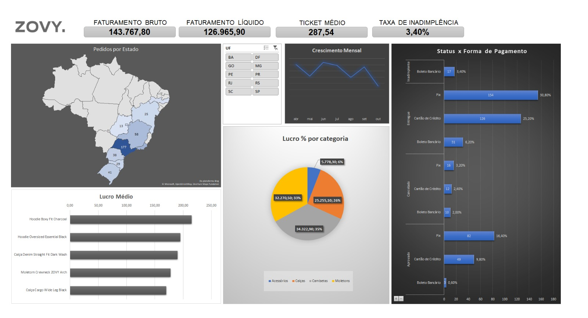

# Dashboard de Performance Comercial E-commerce | ZOVY Streetwear

Este projeto consiste na construção de um dashboard interativo no **Microsoft Excel** para análise do histórico de vendas no e-commerce da marca fictícia de streetwear **ZOVY**.

---

## Painel Geral (Dashboard)

 

---

## Objetivos do Negócio

A análise foi estruturada para responder a três perguntas estratégicas da diretoria:
1. Qual é o faturamento líquido real da empresa após deduzir cancelamentos e inadimplência do faturamento bruto?
2. Quais produtos e categorias possuem as maiores margens de lucro por unidade vendida?
3. Como os métodos de pagamento se comportam em relação ao risco de crédito/inadimplência?

---

## Principais Insights Descobertos

- **Inadimplência Concentrada**: 100% dos pedidos inadimplentes (representando 3,40% do volume total de pedidos) foram originados por compras via **Boleto Bancário**. As modalidades Pix e Cartão de Crédito apresentaram índice zero de inadimplência.
- **Top Produtos de Maior Lucro**: A categoria de **Moletons** e **Camisetas** lidera a rentabilidade do e-commerce, destacando-se o produto **Hoodie Boxy Fit Charcoal** com o maior lucro médio por unidade (R$ 214,90).
- **Geografia de Vendas**: O estado de São Paulo (SP) concentra a maior fatia das entregas nacionais (177 pedidos), seguido pelo Rio de Janeiro (RJ) e Minas Gerais (MG).

---

## Recursos e Funcionalidades Utilizadas no Excel

- **Tratamento de Dados**: Limpeza e estruturação em formato de tabela condicional.
- **Modelagem e Agregação**: Uso de Tabelas Dinâmicas para consolidação de métricas por período, região e status.
- **Fórmulas de Busca e Lógicas**:
  - `CONT.SE` / `CONT.SES` para consolidação de dados frequentes.
  - `ÍNDICE + CORRESP` / `ORDEM.EQ` para estruturação do ranking Top 5 produtos dinâmico.
- **Visualização de Dados e Dashboard (UX/UI)**:
  - Cartões de KPI dinâmicos vinculados às consolidações.
  - Gráfico de mapa geográfico (UF), gráfico de barras invertido e gráfico de crescimento temporal.
  - Segmentação de Dados (*Slicers*) com conexões de relatório para filtragem de gráfico.

---

## Estrutura do Repositório

- `vendas_zovy_ecommerce.csv`: Base de dados sintética utilizada no estudo de caso.
- `dashboard_zovy.xlsx`: Arquivo contendo o painel interativo, tabelas dinâmicas e análises auxiliares.
- `dashboardpreview.png`: Captura de tela em alta resolução do painel finalizado.
